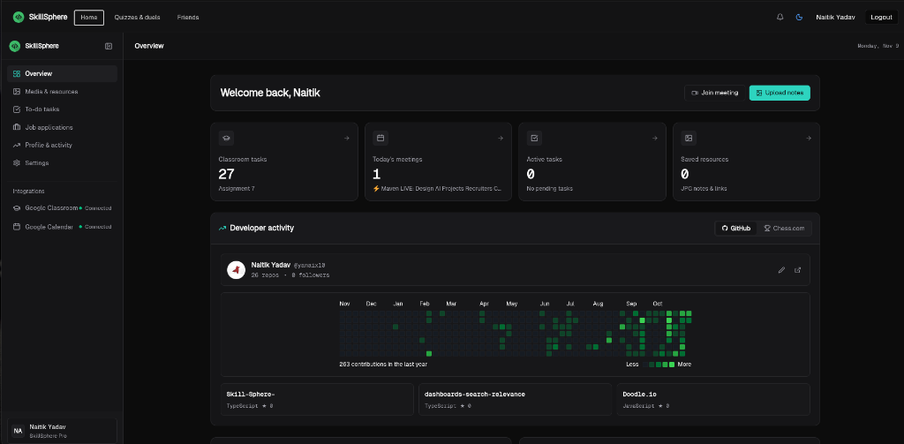
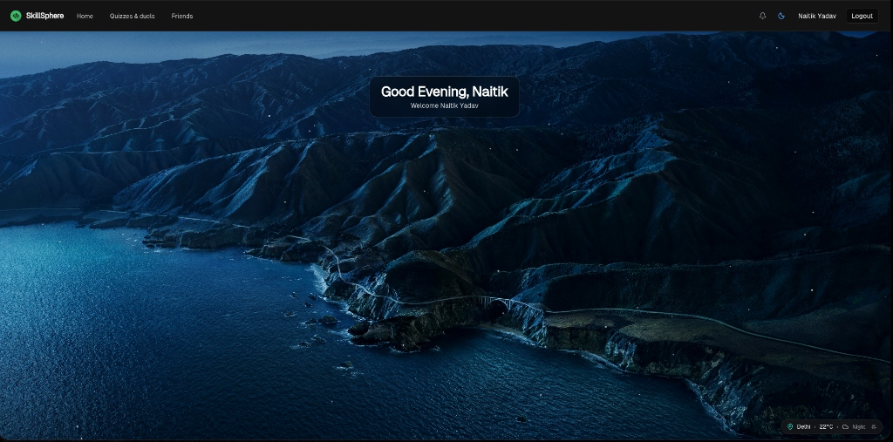

# SkillSphere

SkillSphere is a real-time developer workspace and skill-building platform featuring 1v1 coding duels and interactive technical assessments.
It unifies academic and developer workflows through Google Calendar, Google Classroom, and developer activity tracking.

Live Application: [https://xskillsphere.vercel.app](https://xskillsphere.vercel.app)

---

## Preview

---

## Features

- Real-time 1v1 coding duels with synchronized timers and multi-language execution.
- Interactive practice quizzes across Web Development, Algorithms, and DevOps.
- Centralized developer dashboard with task tracking and GitHub activity metrics.
- Seamless Google Classroom and Google Calendar sync for coursework and meetings.
- Social networking with real-time peer messaging and profile customization.
- Dark, light, and system theme support with dynamic canvas backgrounds.

---

## Feature Requests

The project is ready to accept any features. Feel free to open an issue to suggest improvements or new functionality.

---

## Thank You

Thank you for checking out SkillSphere.
